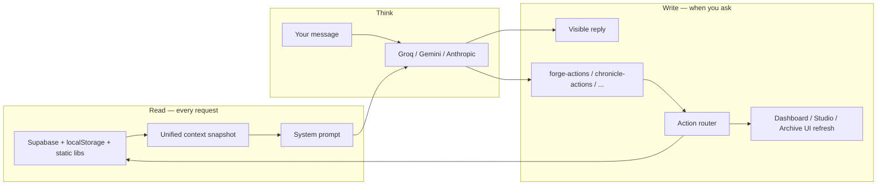
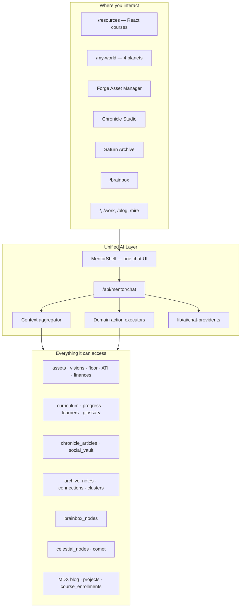
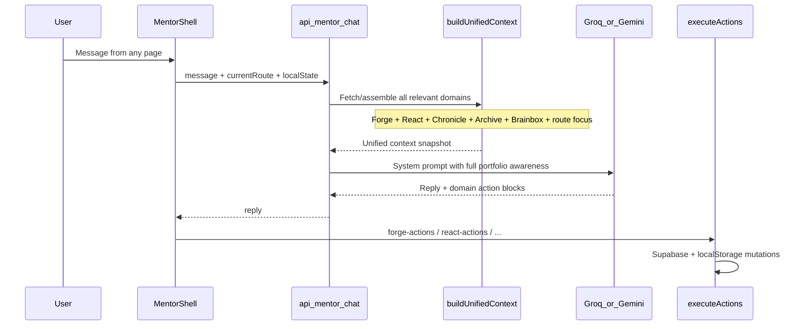

# Project Summary — One AI, Connected to Everything

## Current Workspace Status

The AI connection is documented and partially implemented in this workspace.

Implemented:

- `components/ai/MentorShell.tsx` provides the shared chat UI.
- `components/my-world/asset-manager/ForgeMentorPanel.tsx` is a thin wrapper around the shared shell.
- `app/api/mentor/chat/route.ts` is the unified mentor route currently used by the Forge dashboard.
- `lib/ai/chat-provider.ts` connects to Groq, Gemini, or Anthropic based on available environment keys.
- `lib/ai/context.ts` builds the unified prompt from Forge data plus lightweight Chronicle, Archive, and Brainbox signals.
- `lib/forge/mentor-actions.ts` handles supported Forge write actions returned in fenced `forge-actions` blocks.

Still pending:

- Mounting the shared mentor UI across Chronicle, Archive, and Brainbox.
- React learner onboarding and React-specific mentor actions.
- Chronicle, Archive, and Brainbox write action executors.
- End-to-end provider testing after adding a real `GROQ_API_KEY`, `GEMINI_API_KEY`, or `ANTHROPIC_API_KEY` to `.env.local`.

## The Big Picture

This is **not** two separate AI chatbots (one for React, one for Forge). The goal is **one AI mentor** that lives across your entire portfolio and is **connected to every data domain** — reading context from wherever you are, and editing whatever you're working on through conversation.

The portfolio is already a system of interconnected layers. The AI should mirror that.

## Read + Write — the two halves

Yes — exactly. Every chat request does **two things**:

### 1. Read — feed the AI full context

On each message, the system **assembles a snapshot** of your portfolio data and injects it into the system prompt. The AI doesn't guess — it sees real assets, visions, articles, notes, progress, etc. What's in the foreground depends on which private tool you're in, but the **full picture is available**.

### 2. Write — let the AI manipulate data when you ask

The AI doesn't just advise. When you tell it to (or clearly agree), it returns **structured action blocks** that the app executes:

```
You: "Mark the AutoDrive onboarding action done and bump mandate to 70%"
AI:  "Done — updated AutoDrive."  +  hidden forge-actions JSON
App: Parses actions → updates Supabase/localStorage → UI refreshes
```


| Capability     | Read (context)                        | Write (manipulate)                             |
| -------------- | ------------------------------------- | ---------------------------------------------- |
| Forge assets   | mandates, scores, actions, allocation | update asset, add/toggle actions, create asset |
| Visions        | weights, descriptions, status         | update vision fields                           |
| Floor          | peace / sovereignty signals           | update floor state                             |
| Chronicle      | drafts, vault posts                   | create/edit articles, stage social posts       |
| Archive        | notes, connections                    | create notes, confirm links                    |
| Brainbox       | nodes                                 | create/update nodes                            |
| React learners | progress, enrollments (reference)     | mark lessons, update profile (public layer)    |


**Guardrail:** mutations only when you explicitly request or confirm — the AI explains what it changed in plain language.







---

## What "connected with everything" means

### Read access (context the AI always knows about, scoped + prioritized by where you are)


| Domain        | Data                                                                         | Source                                             |
| ------------- | ---------------------------------------------------------------------------- | -------------------------------------------------- |
| **The Forge** | Assets, visions, floor, mandates, actions, allocation, ATI clients, finances | Supabase `assets`/`visions` + `localStorage` floor |
| **React Hub** | 12 lessons, glossary, learner name/email, lesson progress, XP                | `lib/react-hub/`* + `localStorage`                 |
| **Chronicle** | Drafts, published articles, social vault posts                               | Supabase `chronicle_articles`, `social_vault`      |
| **Archive**   | Research notes, types, AI-suggested connections                              | Supabase `archive_`* tables                        |
| **Brainbox**  | Thought / project / paper / wonder nodes                                     | Supabase `brainbox_nodes`                          |
| **My World**  | Planet nodes, deployed projects on Mercury surface                           | Supabase `celestial_nodes`, `comet`                |
| **Public**    | Case studies, blog posts, hire form context                                  | `lib/projects.ts`, MDX, `contact_submissions`      |
| **Learners**  | Course enrollments                                                           | Supabase `course_enrollments`                      |


### Write access (what conversation can change)

Actions are **domain-tagged** but routed through one system:

- **forge-actions** — update asset, create asset, floor signals, vision weights, mandate actions
- **react-actions** — mark lesson complete, update learner, navigate lesson
- **chronicle-actions** — draft article, update vault post status (future)
- **archive-actions** — create/update notes, confirm connections (future)
- **brainbox-actions** — create/update nodes (future)
- **navigate-actions** — jump to asset, lesson, article, planet, project

The AI only mutates when you ask — but it **can see the full picture** to give advice that crosses domains (e.g. "AutoDrive mandate is behind — want me to draft a Chronicle post about the v2 ship?").

---

## How it relates to work already done

### Implemented (Forge slice — first vertical)

- `[ForgeMentorPanel.tsx](components/my-world/asset-manager/ForgeMentorPanel.tsx)` — chat UI in Asset Manager
- `[lib/forge/mentor-prompt.ts](lib/forge/mentor-prompt.ts)` — forge-specific system prompt
- `[lib/forge/mentor-actions.ts](lib/forge/mentor-actions.ts)` — forge action parse + execute
- `[app/api/forge/chat/route.ts](app/api/forge/chat/route.ts)` — API route
- `[lib/ai/chat-provider.ts](lib/ai/chat-provider.ts)` — Groq / Gemini / Anthropic

This is the **first domain adapter**, not the final architecture.

### Designed but not in workspace (React slice)

- Learner onboarding modal (name + email on course entry)
- `POST /api/course-enroll` → Supabase
- Name on course-complete + resources page when finished
- Progress % on React Fundamentals card
- React Hub mentor with curriculum + progress actions

### Already has AI elsewhere (to unify, not duplicate)

- `[/api/adapt-content](app/api/adapt-content/route.ts)` — Chronicle social distribution (Claude)
- `[/api/archive/footnotes](app/api/archive/footnotes/route.ts)` — archive connections (Haiku)
- `[/api/archive/clusters](app/api/archive/clusters/route.ts)` — semantic clustering (Haiku)

These become **capabilities inside the unified mentor**, not separate one-off flows.

---

## Target architecture




### Where the chat appears

**Private tools only** (your choice):

- Forge Asset Manager (`Dashboard.tsx`)
- Chronicle Studio (`ChronicleStudio.tsx`)
- Saturn Archive (archive write/settings surfaces)
- Optionally Asset Manager adjacent private gates

**Not on** public pages (`/`, `/work`, `/blog`, `/hire`). React `/resources` stays a separate public learning experience with its own lighter progress/onboarding layer — but the **backend still shares the same AI provider and can cross-reference learner data** when you're in private tools.

---

### Key design decisions

1. **One API route** — `POST /api/mentor/chat` replaces per-domain `/api/forge/chat`, `/api/react-hub/chat`, etc.
2. **One chat history** — `localStorage` key `portfolio-mentor-chat` (with optional session reset per domain if needed)
3. **Route-aware focus** — in Forge, assets are foregrounded; in Chronicle, drafts are foregrounded — but **full portfolio data is always available** to the model
4. **One floating UI** — `MentorShell` inside **private tools only** (Forge Dashboard, Chronicle Studio, Archive, Asset Manager) — not on public `/`, `/blog`, `/hire` pages
5. **Server-side context fetch** — API loads Supabase data directly (assets, visions, articles, archive, brainbox) so the client doesn't send everything

---

## User journeys (all through the same AI)


| You are...                    | AI knows...                                                 | AI can do...                                                 |
| ----------------------------- | ----------------------------------------------------------- | ------------------------------------------------------------ |
| In Forge Dashboard            | Full asset ledger + floor + visions + all cross-domain data | Update mandates, add actions, rebalance focus                |
| In Chronicle Studio           | Your drafts + vault + forge assets for context              | Help write, adapt for LinkedIn/X (reuse adapt-content logic) |
| In Archive                    | Notes + connections + related assets                        | Summarize clusters, suggest links, create notes              |
| In Brainbox (private session) | Orbiting nodes + portfolio context                          | Discuss ideas, add nodes                                     |


---

## Implementation phases

### Phase 1 — Unify what exists

- Merge `ForgeMentorPanel` into `MentorShell`
- Create `lib/ai/unified-context.ts` + `lib/ai/action-router.ts`
- Single `/api/mentor/chat` route
- Mount mentor globally; Forge Dashboard uses shared shell

### Phase 2 — Re-apply React + learner layer

- Onboarding modal, enrollment API, personalization
- `react-actions` in unified action router
- Progress sync to Supabase (optional)

### Phase 3 — Connect remaining domains

- Chronicle read/write actions
- Archive note actions
- Brainbox node actions
- Cross-domain prompts ("link this asset to that article")

### Phase 4 — Polish

- Streaming responses
- Confirmation before destructive edits
- Auth gate for private domains (Forge, Chronicle, Archive)

---

## API keys

One key powers everything:

```env
GROQ_API_KEY=...     # free, recommended
# or
GEMINI_API_KEY=...   # free tier
# optional
ANTHROPIC_API_KEY=...  # fallback + existing Chronicle/archive routes until merged
```

---

## One-line summary

**One AI mentor across the whole portfolio — knows your forge ledger, course progress, writing, archive, brainbox, and projects, and can edit any of it through conversation depending on what you're doing.**
